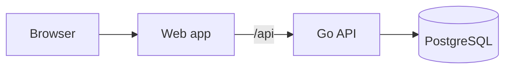

# Architecture

## Components

**API.** A Go service with a REST interface for users, events, locations and reservations, authenticated with JWT. It listens on `8080`, runs as a non-root user from a distroless image and creates its schema on first start. The Swagger spec is `docs/swagger.yaml`.

**Database.** PostgreSQL. Compose runs `postgres:17-alpine`.

**Web app.** A React single-page app (React 19, react-router 7, axios). It calls the relative `/api`. In compose, nginx serves it and forwards `/api/` to `USHER_API_URL`.

## Production

The public demo runs the same two images, split in two:

- **Web.** A Cloudflare Worker serves the built app and proxies `/api/*` to the API. It rate-limits requests, caps body size and adds a shared-secret header, `X-Usher-Proxy-Key`.
- **API.** Runs on a small k3s cluster, deployed by Argo CD from the manifests in `k8s/`. With `PROXY_SHARED_SECRET` set, it refuses requests without that header, except `GET /api/health` and CORS preflights. A daily CronJob resets the demo data at 04:00 UTC.
