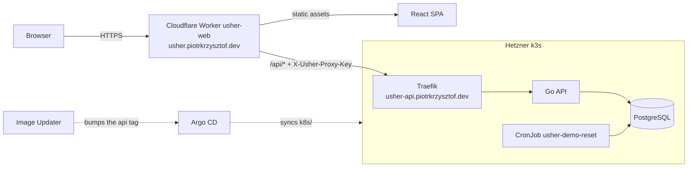

# Architecture

## Components

**API.** A Go service with a REST interface for users, events, locations and reservations, authenticated with JWT. It listens on `8080`, runs as a non-root user from a distroless image and creates its schema on first start. The Swagger spec is `docs/swagger.yaml`.

**Database.** PostgreSQL. Locally compose runs `postgres:17-alpine`. In production the API uses a role and database named `usher` on the shared Postgres in the `databases` namespace.

**Web app.** A React single-page app (React 19, react-router 7, axios). It calls the relative `/api`. In compose, nginx serves it and forwards `/api/` to `USHER_API_URL`. In production it is not deployed to Kubernetes.

**Cloudflare Worker.** The production SPA is the Worker `usher-web`, with the custom domain `usher.piotrkrzysztof.dev`. It serves the built assets and runs first only for `/api/*`, which it proxies to `https://usher-api.piotrkrzysztof.dev`. Before proxying it:

- rate limits per client IP (IPv6 clients by /64): 10 requests per minute for `login`, `register` and `logout` calls that are not `GET`, 120 per minute for every other `/api` request. A limited request gets `429` with `Retry-After: 60`.
- rejects request bodies over 64 KiB (`413`) and bodies without a `Content-Length` (`411`).
- strips cookies and any client-sent `X-Forwarded-*` and `X-Usher-Proxy-Key` headers, then sets its own `X-Usher-Proxy-Key` from the secret `PROXY_SHARED_SECRET`.

**Proxy key.** With `PROXY_SHARED_SECRET` set, the API answers `403` to everything without the `X-Usher-Proxy-Key` header except `GET /api/health` and CORS preflights. Direct hits on the public API host are refused. This is a bypass guard, not a secret hiding the host.

**Kubernetes.** The API runs on a k3s cluster. Argo CD reads the manifests in `k8s/` from `master`. Image Updater bumps the `api` image tag in `k8s/kustomization.yaml` on `master`. A CronJob, `usher-demo-reset`, wipes and re-seeds the demo data daily at 04:00 UTC. The steps are in [Deployment](deployment.md).
